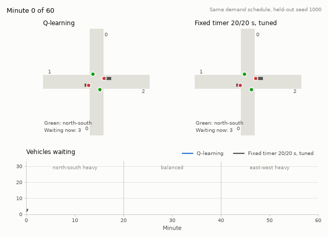
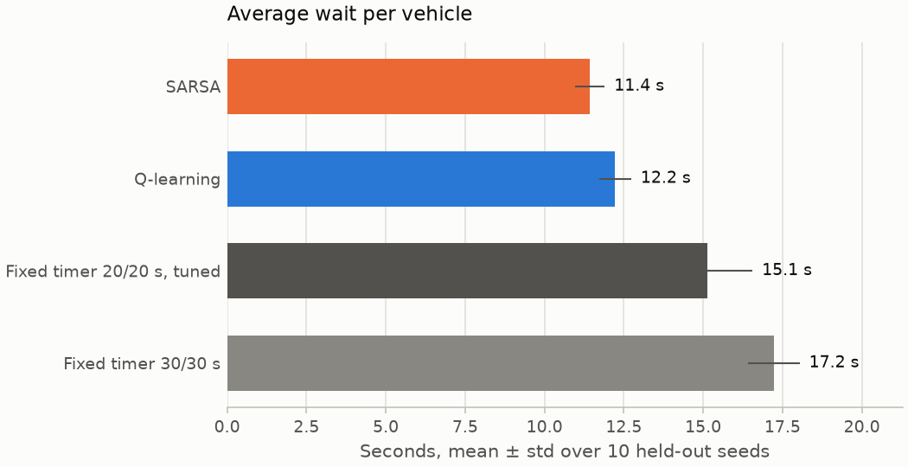
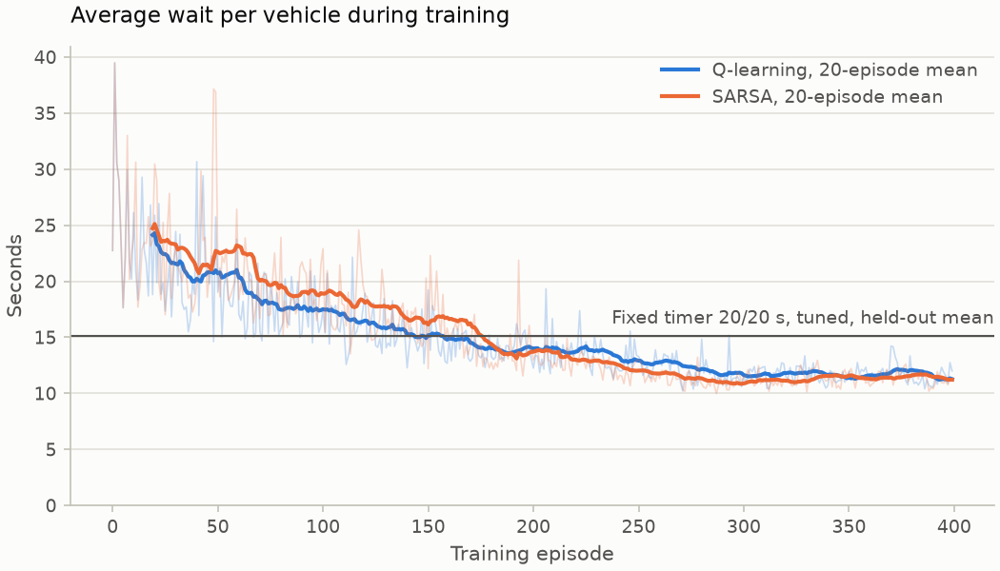

# Adaptive Traffic Signal Control

A reinforcement learning controller for the signals at a four-way intersection. Every five
seconds it decides whether to keep the current green or switch, based on the queues it can
see. Trained in simulation, it cuts the average wait per vehicle by 19–38% compared with
the best fixed-time plan we could tune.

**Live demo:** https://adaptive-traffic-signal-control-8x5zgibkmr432uaitwwtf7.streamlit.app.
Set the traffic yourself and watch the trained agent and two fixed timers handle it. If
nobody has visited in a while, the app takes a few seconds to wake up.



The left intersection is run by the trained Q-learning agent and the right one by the tuned
fixed timer, both facing the same random arrivals. Demand starts north-south heavy, evens
out, then turns east-west heavy. A fixed split can only suit one of those periods, so the
timer's queues build up in the last third while the agent's stay short.

## Results

Average wait per vehicle over 10 held-out seeds (1000–1009). No agent was trained on these
seeds and the timer was not tuned on them.

| Controller | Average wait (s) |
|---|---|
| DQN | 9.35 ± 0.32 |
| SARSA | 11.43 ± 0.47 |
| Q-learning | 12.22 ± 0.51 |
| Fixed timer 20/20 s, tuned on training seeds | 15.14 ± 1.41 |
| Fixed timer 30/30 s | 17.23 ± 0.81 |



All three learning agents start from scratch and improve with experience:



A few things worth knowing when reading these numbers:

- **The baseline is tuned honestly.** The fixed timer's green split comes from a grid search
  on training seeds. A 15/15 split would score slightly better on the test seeds (14.84 s),
  but picking it there would leak the test set into the baseline.
- **SARSA and Q-learning are a tie.** The table shows one training run each. Retrained with
  three seeds, Q-learning averages 11.32 ± 0.64 s and SARSA 11.56 ± 0.32 s. The gap
  between the two is smaller than the spread between seeds of the same agent.
- **DQN comes with caveats.** It is a single training run, and it uses a discount of 0.99
  against 0.95 for the tabular agents. So part of its lead may come from planning further
  ahead rather than from the neural network.
- **The results are reproducible.** Before DQN was added, a fresh clone running the
  pipeline reproduced the committed table, tabular models, plots and GIF byte for byte.
  Retraining DQN gives identical network weights; the saved zip differs only in its
  timestamps.

## How it works

The environment is a small simulator behind the [Gymnasium](https://gymnasium.farama.org/) API:

- four single-lane approaches with Poisson arrivals
- a green approach releases a vehicle with probability 0.5 per second (1800 vehicles per
  hour)
- every phase change costs 3 s of yellow with no departures

| | Definition |
|---|---|
| Observation | Queue length on each approach, the current phase, seconds of green so far |
| Action | Which phase to show next: hold the current one, or switch |
| Reward | `-0.01 × queue-seconds in the step − 0.1 × (1 if it switched)` |
| Episode | One simulated hour, a decision every 5 s of green |

Queue-seconds was chosen as the reward because summing it over an episode gives exactly
the total delay that the evaluation measures. The tabular agents bin the observation into
1536 states. DQN works on the raw values scaled to [0, 1].

The tabular agents also showed why generalisation matters. About two thirds of the 1536
states are never visited in training, so their values stay at zero. On one test seed the
first trained Q-table held north-south green for 40 simulated minutes, because a plain
argmax on a tie always picked "hold". Breaking ties at random fixed it, but the table
still knows nothing about states it hasn't seen. A neural network does, which is the
motivation for DQN.

## Running it

Python 3.11. From the repository root:

```bash
python -m venv .venv
source .venv/bin/activate          # Windows: .venv\Scripts\activate
pip install -e ".[dev]"
./scripts/check.sh                 # lint, format, types, tests, 5-episode smoke train
```

Train, evaluate and render the GIF:

```bash
python -m traffic_rl.train --agent q_learning     # or sarsa; about 40 s each
python -m traffic_rl.evaluate                     # writes results/evaluation.csv and plots
python -m traffic_rl.demo                         # writes results/demo.gif
```

Or run everything with one command (about 4 minutes, plus 3 for DQN):

```bash
./scripts/run_full_pipeline.sh
```

Optional extras:

| Extra | Adds | Install |
|---|---|---|
| `dqn` | Stable-Baselines3 and PyTorch, for `--agent dqn` | `pip install -e ".[dqn]"` |
| `sumo` | The SUMO simulator, as a second backend (`envs/sumo_env.py`) | `pip install -e ".[sumo]"` |
| `app` | Streamlit, for the interactive demo | `pip install -e ".[app]"` |

Without the `dqn` extra, the pipeline skips DQN, and the regenerated table and plots
won't include it.

The interactive demo runs the trained agent and both timers on traffic you set with
sliders:

```bash
streamlit run app/streamlit_app.py
```

Hyperparameters are in `configs/*.yaml`. Training writes per-episode logs to
`results/runs/` and checkpoints to `results/checkpoints/` (both git-ignored). The final
models go to `results/models/`.

## What's implemented and what isn't

Implemented and measured:

- the custom simulator, with contract tests (Gymnasium checker, vehicle conservation,
  yellow handling)
- fixed-timer baseline, default and tuned
- tabular Q-learning, SARSA and DQN, all trained from YAML configs and compared on
  held-out seeds
- an optional SUMO backend through TraCI with the same spaces and reward. On a cross-check
  it ranks fixed timers the same way as the custom simulator.
- the demo GIF, the interactive Streamlit app and a one-command pipeline
- `scripts/check.sh`: lint, format, type check, tests and a short smoke training run.
  A pre-push hook and the CI workflow both run it.
- the live Streamlit deployment, redeployed from `main` on every push

Not done:

- multiple coordinated intersections
- turning movements, pedestrians, real traffic counts
- evaluating the trained agents inside SUMO; they would need retraining there, because
  SUMO counts queues differently
- several DQN training seeds, and a DQN run with the same discount as the tabular agents
- PPO or actor-critic methods, which are more machinery than a two-action problem needs

## Repository layout

```
src/traffic_rl/
  envs/          simulator (simple_env), SUMO backend (sumo_env), shared spaces (base_env)
  agents/        Q-learning, SARSA, DQN
  baselines/     fixed timer
  episode.py     the single episode loop every controller runs through
  train.py       training CLI
  evaluate.py    held-out comparison, results table and plots
  demo.py        demo GIF
app/             Streamlit demo
configs/         hyperparameters
results/         committed models, evaluation table, plots and GIF
tests/           pytest suite
```

The requirements the build was checked against are in [REQUIREMENTS.md](REQUIREMENTS.md).

## References

Papers and books:

- Sutton, R. S. & Barto, A. G. (2018). *Reinforcement Learning: An Introduction*, 2nd ed.
  Chapter 6 covers Q-learning and SARSA.
- Watkins, C. J. C. H. & Dayan, P. (1992). Q-learning. *Machine Learning*, 8(3–4),
  279–292.
- Rummery, G. A. & Niranjan, M. (1994). *On-line Q-learning using connectionist systems*.
  Technical Report CUED/F-INFENG/TR 166, Cambridge University. The origin of SARSA.
- Mnih, V. et al. (2015). Human-level control through deep reinforcement learning.
  *Nature*, 518, 529–533. DQN, with experience replay and a target network.
- Raffin, A. et al. (2021). Stable-Baselines3: Reliable Reinforcement Learning
  Implementations. *JMLR*, 22(268), 1–8.
- Lopez, P. A. et al. (2018). Microscopic Traffic Simulation using SUMO. *IEEE ITSC*.
- Highway Capacity Manual: the 1800 vehicles per hour per lane saturation flow used as
  the departure rate.

Libraries (pinned versions in `pyproject.toml`):

- [Gymnasium](https://gymnasium.farama.org/): environment API
- [NumPy](https://numpy.org/): simulator and Q-table
- [matplotlib](https://matplotlib.org/): plots and the demo GIF
- [PyYAML](https://pyyaml.org/): config files
- [Stable-Baselines3](https://stable-baselines3.readthedocs.io/) and
  [PyTorch](https://pytorch.org/): DQN
- [SUMO](https://eclipse.dev/sumo/) and TraCI: the optional second simulator
- [Streamlit](https://streamlit.io/): the live demo
- [pytest](https://pytest.org/), [ruff](https://docs.astral.sh/ruff/) and
  [mypy](https://mypy-lang.org/): tests and static checks

Platform documentation consulted when choosing where to host the demo: the Hugging Face
Spaces overview (hardware and plan requirements) and Streamlit Community Cloud's
"Manage your app" page (resource limits and sleep behaviour).

## License

MIT. See [LICENSE](LICENSE).
